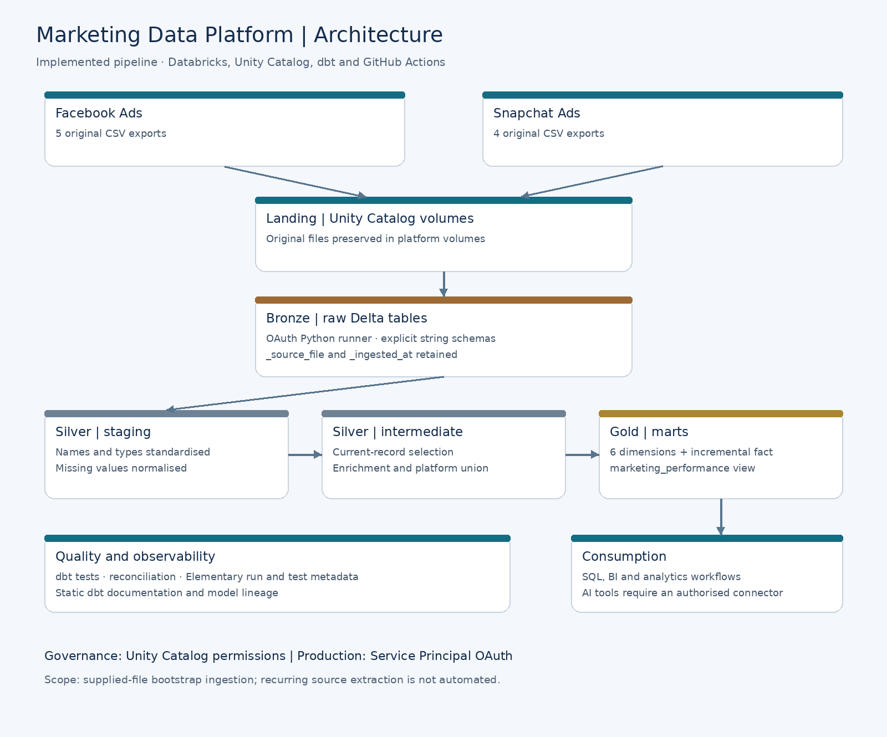

# Marketing Data Platform

**Unified Facebook Ads and Snapchat Ads analytics with Databricks, dbt and GitHub Actions.**

## Business problem

Marketing needs a consistent view of advertising spend, impressions, clicks and campaign performance. Reviewing platforms separately and combining CSV exports in spreadsheets makes analysis slow, difficult to reproduce and hard to share with other teams.

Facebook and Snapchat also structure their data differently. Combining their exports without a defined grain, controlled joins and metric reconciliation risks duplicated spend and misleading comparisons.

This project converts the supplied exports into a reusable analytical data product: a governed star schema and an accessible reporting view, supported by automated tests, documentation and production deployment.

## Solution and architecture

Original files land in Unity Catalog volumes. Raw Delta tables preserve source values and ingestion metadata. dbt cleans and integrates the platforms, then builds dimensions, a daily performance fact and a reporting view.



| Layer | Responsibility | Medallion alignment |
|---|---|---|
| `landing` | Preserve original CSV files in volumes | Before Bronze |
| `raw` | Retain source values and ingestion metadata in Delta tables | Bronze |
| `staging` | Standardise names, types and missing values | Silver |
| `intermediate` | Resolve history records, enrich statistics and unify platforms | Silver |
| `marts` | Serve dimensions, the performance fact and reporting view | Gold |

**Stack:** Databricks SQL, Delta Lake, Unity Catalog, dbt, Python, uv, Elementary and GitHub Actions.

## Gold analytical model


`fact_ad_daily_performance` contains one row per **platform, account ID, ad ID, reporting date, currency code and country code**. Country remains nullable where the source does not supply it.

Six dimensions provide platform, date, account, campaign, ad-group and ad context. Entity keys include the platform to prevent identifier collisions. Dimensions hold current descriptive attributes; they do not reconstruct attribute history.

The `marketing_performance` view joins the fact to these dimensions without changing its grain, giving SQL and BI users a reusable reporting interface. An AI analytics tool can use the same interface through an authorised connector; no AI connector is implemented here.

Relationships in the diagram are validated through dbt tests, rather than enforced database foreign-key constraints.

## Design decisions and trade-offs

| Decision | Benefit | Trade-off |
|---|---|---|
| Preserve raw fields as strings | Keep source evidence and centralise type conversion in dbt | Raw tables require transformation before analysis |
| Star schema with a reporting view | Reuse dimensions and simplify business queries | More models and relationships to maintain |
| Preserve missing metrics as NULL | Distinguish unknown activity from genuine zeros | Reports need explicit completeness checks |
| Incremental Delta merge with a full source scan | Apply corrections to older dates without an unreliable watermark | Writes are incremental; source scanning is not optimised |
| Full-project PR builds | Exercise relationships and reconciliation across the dataset | More warehouse usage than slim CI |

Snapchat ad groups contain 267 source records for 264 IDs. Raw preserves all records; an intermediate model selects the current record before enrichment to prevent duplicated statistics.

[Detailed decisions and limitations →](docs/decisions.md)

## Validation and delivery evidence

The local production build passed **110 data tests**, with zero warnings, errors or skipped resources. PR CI and the first GitHub production deployment also completed successfully.

| Platform | Fact rows | Distinct fact keys | Missing impressions | Missing clicks |
|---|---:|---:|---:|---:|
| Facebook | 92,300 | 92,300 | 1,474 | 24,337 |
| Snapchat | 2,809 | 2,809 | 0 | 111 |
| **Total** | **95,109** | **95,109** | **1,474** | **24,448** |

Tests cover required keys, uniqueness, dimension relationships, row-count preservation, unified grain and metric reconciliation. Manual integration checks verified fact inserts, updates and repeat-run idempotency.

Static dbt documentation and model lineage were generated and inspected. Elementary collects execution and test metadata; its HTML reporting has a known display limitation for some tests referencing multiple models.

## Business questions and metric rules

The reporting view supports spend by platform and campaign, impressions and clicks by campaign, campaign rankings and performance trends.

Calculate **CPC = total spend / total clicks** and **CPM = 1,000 × total spend / total impressions** over the same reporting scope. Use ratios of totals, withhold ratios for incomplete inputs or zero denominators, and show missing-metric coverage alongside reported totals.

Spend must remain separated by currency unless a documented FX conversion is applied. The supplied Snapchat statistics cover 2024 and Facebook statistics cover 2025, so their totals do not represent a like-for-like platform comparison. Source click definitions, spend units and timezone conventions also require confirmation before business interpretation.

[Model details, metric definitions and example SQL →](docs/data-model.md)

## Environments, security and deployment

- **Development:** `marketing_dev`, for local development and validation.
- **CI:** `marketing_ci`, with isolated schemas for each pull request.
- **Production:** `marketing_prod`, deployed from protected `main` through GitHub Actions.

CI and production authenticate through Service Principals using OAuth. Unity Catalog controls data access, while GitHub environment secrets keep credentials outside the repository. The `staging` schema is a transformation layer, not a separate deployment environment.

PR CI builds and tests the project against development raw data. Production explicitly reads production raw data, builds models, runs tests and generates documentation. Production runs do not overlap. Deployment is not atomic: a later failure does not roll back objects already changed.

[CI/CD diagram, workflow details and permissions →](docs/deployment.md)

## Quick start

Prerequisites: uv, authorised Databricks access, the supplied raw data and an untracked local dbt profile. Run from the repository root:

```powershell
uv python install 3.12.9
uv sync --locked
cd unified_mkt_platform
uv run --locked dbt deps --target dev
uv run --locked dbt debug --target dev
uv run --locked dbt build --target dev --fail-fast
```

Configure connection variables before running these commands. Never commit local profiles, tokens, OAuth secrets or `.env` files.

[Setup, repository layout and ingestion instructions →](docs/setup.md)

## Current scope and next improvements

The pipeline is validated against the supplied CSVs. Ingestion scripts create the initial raw tables; recurring file extraction and loading are not automated. The fact merge does not automatically remove deleted source rows or handle changed grain keys as deletions.

Next improvements include retained documentation artifacts, automated incremental integration checks, CI schema cleanup, group-based consumer grants and freshness monitoring aligned to a real extraction schedule.

[Documentation and Elementary usage →](docs/observability.md) · [Design limitations →](docs/decisions.md)
