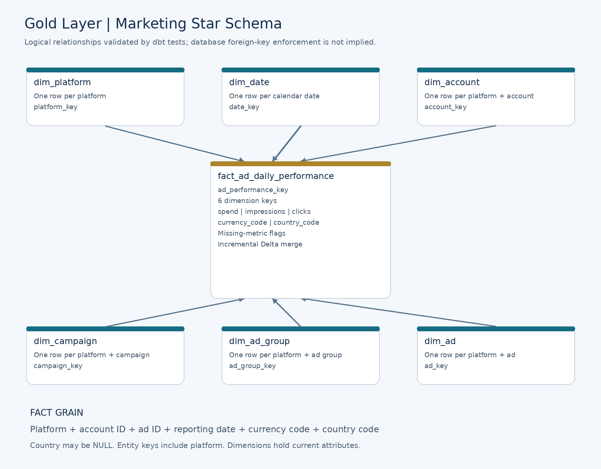

# Data model and metric definitions

[Back to project overview](../README.md)

## Analytical model and grain




### Fact

`fact_ad_daily_performance` has one row per distinct combination of:

**platform + account ID + ad ID + reporting date + currency code + country code.**

Country is nullable because the Facebook export does not provide it. Currency and country are part of the grain so distinct reporting slices are not accidentally combined. A deterministic hash of this combination forms `ad_performance_key`, with explicit handling of NULL values.

The fact stores spend, impressions and clicks, dimension keys, source metadata and missing-metric indicators. It uses an incremental Delta merge keyed by `ad_performance_key`.

### Dimensions

| Model | Grain | Purpose |
|---|---|---|
| `dim_platform` | One row per advertising platform | Shared platform labels |
| `dim_date` | One row per calendar date | Consistent calendar analysis |
| `dim_account` | One row per platform and account ID | Account context |
| `dim_campaign` | One row per platform and campaign ID | Campaign labels and grouping |
| `dim_ad_group` | One row per platform and ad-group ID | Ad-group labels |
| `dim_ad` | One row per platform and ad ID | Ad labels and available status |

Each fact row references one row in each dimension; each dimension row can be referenced by many fact rows. Platform-qualified entity keys prevent collisions between Facebook and Snapchat identifiers.

The source hierarchy is resolved in intermediate models. The fact carries the dimension keys directly, allowing analysts to filter campaigns, ads and accounts without traversing the source hierarchy.

### Reporting interface

`marketing_performance` joins the fact to its dimensions and preserves the fact grain. It exposes descriptive labels, dates, original identifiers, currency, country and metrics for SQL and BI consumption. It is a view so it does not store another copy of the joined dataset.


## Source handling and data quality

- Facebook supplies five raw tables: accounts, campaigns, ad groups, ads and statistics.
- Snapchat supplies four: campaigns, ad groups, ads and statistics. Account identifiers are available through campaigns; account names are not supplied.
- Source strings representing missing values are normalised before conversion. Missing numeric values are retained as NULL rather than replaced with zero.
- Timestamp cleaning preserves meaningful timestamp characters, including `T` and `Z`.
- Snapchat ad-group data contains 267 records for 264 distinct IDs. `int_snapchat_ad_groups_current` selects the latest available record using its update timestamp and a deterministic tie-breaker.
- Fact enrichment uses left joins and quality checks so missing relationships are detectable rather than silently dropping statistics rows.

### Validation evidence

The first local production build completed with **110 data tests**, zero warnings, zero errors and zero skipped resources. The reported `PASS=163` includes models and hooks; it is not a count of tests.

| Platform | Reporting rows | Distinct fact keys | Missing impressions | Missing clicks |
|---|---:|---:|---:|---:|
| Facebook | 92,300 | 92,300 | 1,474 | 24,337 |
| Snapchat | 2,809 | 2,809 | 0 | 111 |
| Total | 95,109 | 95,109 | 1,474 | 24,448 |

Tests cover required keys, uniqueness, dimension relationships, source-to-intermediate row counts, metric reconciliation, unified grain, and unified-to-fact reconciliation.

Controlled integration checks also verified insertion of a new fact row, updating an existing row and rerunning without duplicate keys. These checks were executed manually; they are not yet an automated incremental-test harness in CI.


## Metric definitions and analysis rules

| Metric | Definition |
|---|---|
| Spend | Sum of reported spend within a single currency |
| Impressions | Reported ad displays; not unique people reached |
| Clicks | Reported source click count; cross-platform click-definition equivalence requires confirmation |
| CPC | Total spend divided by total clicks for the same complete reporting scope |
| CPM | 1,000 × total spend divided by total impressions for the same complete reporting scope |

Calculate ratios from aggregated totals, not by averaging row-level CPC or CPM. Withhold a ratio when its input scope contains missing spend or denominator values, or the total denominator is zero. A sum of known clicks or impressions is a partial total when missing values exist.

Do not sum spend across currencies without a documented conversion policy. The supplied platforms cover different periods: Snapchat statistics cover 2024 and Facebook statistics cover 2025. Comparing their totals does not establish like-for-like platform effectiveness. Currency units, source timezone conventions and metric semantics should be confirmed before drawing business conclusions.

### Example: spend and metric coverage by platform and currency

Run in Databricks SQL:

```sql
SELECT
    platform_code,
    currency_code,
    MIN(reporting_date) AS first_reporting_date,
    MAX(reporting_date) AS last_reporting_date,
    SUM(spend) AS total_spend,
    SUM(impressions) AS known_impressions,
    SUM(clicks) AS known_clicks,
    COUNT_IF(impressions IS NULL) AS rows_missing_impressions,
    COUNT_IF(clicks IS NULL) AS rows_missing_clicks,
    CASE
        WHEN COUNT_IF(spend IS NULL OR clicks IS NULL) = 0
             AND SUM(clicks) > 0
        THEN SUM(spend) / SUM(clicks)
    END AS cpc,
    CASE
        WHEN COUNT_IF(spend IS NULL OR impressions IS NULL) = 0
             AND SUM(impressions) > 0
        THEN 1000.0 * SUM(spend) / SUM(impressions)
    END AS cpm
FROM marketing_prod.marts.marketing_performance
GROUP BY platform_code, currency_code
ORDER BY platform_code, currency_code;
```

For campaign analysis, group by platform, campaign ID, campaign name and currency. Add reporting date or month for trends. Rank campaigns by known impressions or clicks while displaying missing-value coverage alongside the ranking.
