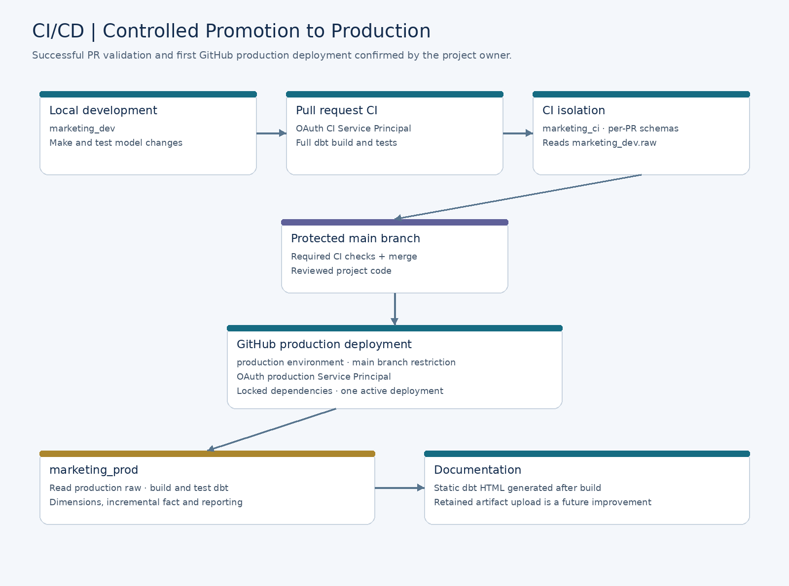

# Deployment and access control

[Back to project overview](../README.md)

## Security and governance

Unity Catalog organises the catalogs, schemas, tables and volumes. Production execution uses a dedicated Service Principal with OAuth rather than a personal access token. Warehouse access and Unity Catalog privileges are both required.

The production Service Principal has volume read access and the schema privileges needed to create, read and modify pipeline objects. SQL consumers need `USE CATALOG`, `USE SCHEMA` and `SELECT` on their approved reporting objects. A personal SQL Editor user does not inherit the Service Principal's permissions.

Reporting-view read access was verified for a user account. Group-based consumer grants are a remaining governance improvement; broad raw access is not required merely to consume the reporting view.

## CI/CD

### Pull-request CI

`dbt-ci.yml` runs on same-repository pull requests targeting `main`, including updates and transitions from draft to ready for review. It:

1. Checks out code and installs pinned tooling and locked Python dependencies.
2. Creates a temporary profile from `unified_mkt_platform/ci/profiles.yml.example`.
3. Installs dbt packages and checks that their lockfile is unchanged.
4. Validates the CI OAuth connection.
5. Builds and tests the whole project in per-PR schemas.
6. Removes the temporary profile.

The configured main-branch protection requires the CI check. Failure and recovery were verified with an intentional failing test followed by its removal. CI is a full build; it does not use production manifests, slim selection or deferral. Per-PR schemas are not automatically removed after closure.

### Production deployment

`dbt-prod.yml` runs on pushes to `main` and supports manual execution from `main`. It references the GitHub `production` environment, whose branch policy permits `main`, and uses its four production secrets listed above.

The workflow prepares the production profile, installs locked dependencies and dbt packages, checks the connection, builds and tests production, then generates static documentation. Concurrent production runs are prevented and an active run is not cancelled by a newer run.

The deployment rebuilds table dimensions, replaces views and merges the incremental fact. It does not execute the raw-ingestion scripts. A failed deployment is not an atomic rollback: objects already changed can remain changed even if a later test fails.

**Deployment status:** local production build, reporting validation, PR CI and the first GitHub production deployment completed successfully. PR #1 was merged to `main` as commit `97b0177`.

The workflow currently generates documentation without uploading it as a retained artifact. Automated Elementary HTML generation and upload are not yet part of the deployment workflow.
